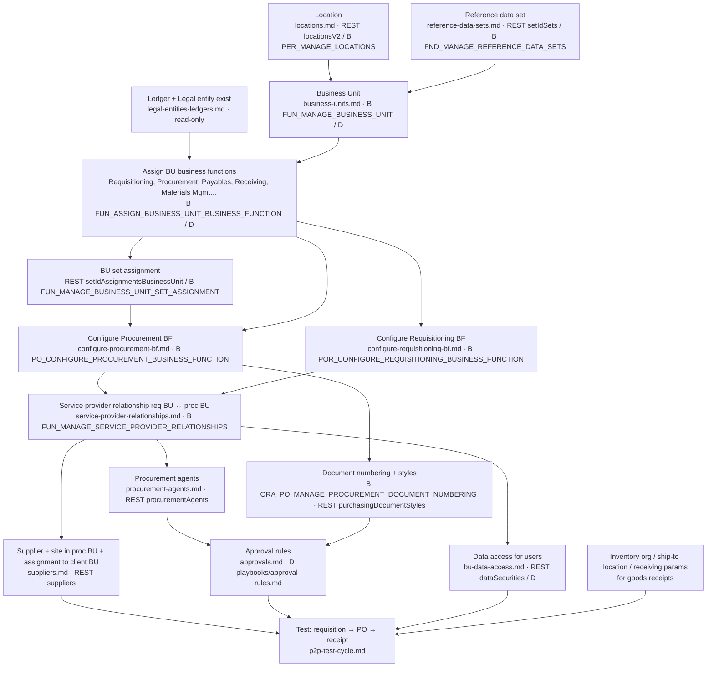

# Setup dependency graph (what must exist before what)

> Release: 26D · Built from the knowledge files in this folder (each node links to its file) + TaskCodes verified on the TEST pod (`fsm-task-codes.md`).
> Rule: before creating/changing a node, check that every node it points FROM exists (read it in Fusion). Missing → add it to the plan first, in this order.

## New Business Unit end-to-end (P2P-ready)

### Same chain as an ordered checklist
1. **Location** (ship-to / receiving / bill-to flags) — `locations.md`
2. **Reference data set** (or use COMMON / existing) — `reference-data-sets.md`
3. **Ledger + legal entity exist** (read-only; needed for Requisitioning, Payables Invoicing, Receiving, Materials Management, Billing, Customer Payments, Expense, Collections, Project Accounting) — `legal-entities-ledgers.md`
4. **Business Unit** (name, location, manager, default set) — `business-units.md` — HIGH-IMPACT
5. **Assign business functions** (+ primary ledger + default legal entity where required) — HIGH-IMPACT
6. **BU set assignment** (must be saved even with no change) — `reference-data-sets.md`
7. **Configure Procurement Business Function** (procurement BU) — `configure-procurement-bf.md`
8. **Configure Requisitioning Business Function** (requisitioning BU: default procurement BU, deliver-to, destination org, one-time location, conversion rate type) — `configure-requisitioning-bf.md`
9. **Service provider relationship** (requisitioning BU → procurement BU; also client BUs for supplier site assignments) — `service-provider-relationships.md`
10. **Procurement agents** (buyers on the procurement BU) — `procurement-agents.md`
11. **Data access for users** (BU / inventory org) — `bu-data-access.md`
12. **Document numbering** (per sold-to legal entity in 26D) + **document styles** + line types — `configure-procurement-bf.md`, `document-styles.md`, `line-types.md` — numbering HIGH-IMPACT
13. **Approval rules** (requisition / purchasing document) — `approvals.md` — HIGH-IMPACT
14. **Suppliers** with a site in the procurement BU assigned to the requisitioning BU — `suppliers.md`
15. **Test**: requisition → approval → PO → receipt — `p2p-test-cycle.md`

## Supplier
Procurement BU (with Procurement BF) → client BU served by it (service provider) → **supplier** → **address** → **site** (proc BU, on the address) → **site assignment** (client BU + bill-to BU, needs Payables Invoicing on bill-to BU for invoicing) → **contacts** → (bank account: Financials, high-impact, `suppliers.md`). Supplier numbering must be set up (`supplier-setup.md`).

## Requisition
Requisitioning BU with Requisitioning BF → preparer is a user with a person record + requester role + data access → deliver-to location (in the BU's set) → destination org (for inventory destination) → category / item → charge account defaults (expense) → approval rules (or auto-approve).

## Purchase order
Procurement BU with Procurement BF → buyer = procurement agent with Manage Orders on that BU → document style (active) → line type → supplier site (purchasing flag) assigned to the requisitioning (sold-to) BU → ship-to org/location → numbering → approval rules.

## Receipt
Approved, open PO with receipt-required schedule → inventory/receiving org with **receiving parameters** (`receiving-parameters.md`) → for inventory destination: subinventory (+ locator if controlled) (`subinventories-locators.md`) → user with receiving role + inventory org data access.

## Inventory org
Location → management BU + legal entity (+ profit center BU) → item master org (`item-organizations.md`) → inventory org (`inventory-organizations.md`) → org parameters (schedule required) → subinventories / locators → receiving parameters → interorg parameters / shipping networks (`shipping-networks.md`) → transfer orders (`transfer-orders.md`).

## Items
Item master org → item class (UI / B `EGO_MANAGE_ITEM_CLASSES`) → UOMs (`uoms.md`) → catalogs / categories (`procurement-categories-catalogs.md`) → item (`items-item-classes.md`) → org assignment.

## Carrier
Lookups WSH_SERVICE_LEVELS / WSH_MODE_OF_TRANSPORT → **carrier** → **shipping method** (service level + mode) → **organization association** (inventory org) — `carriers.md`.
